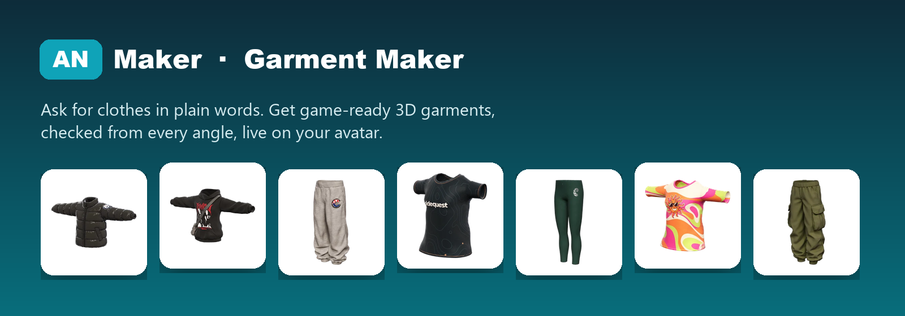
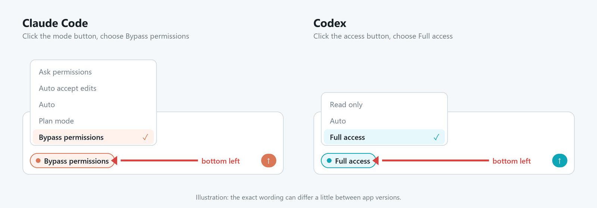
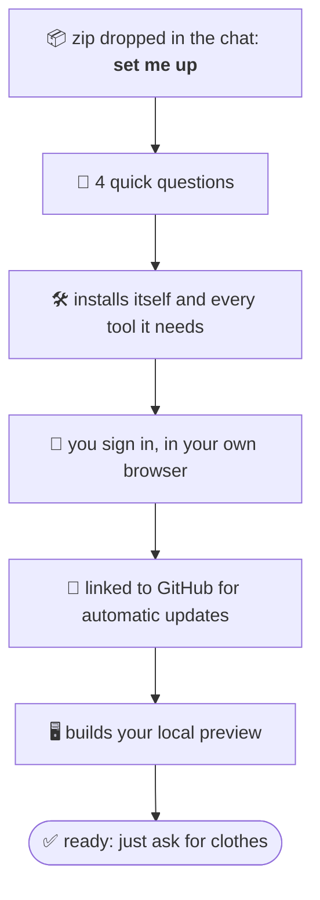
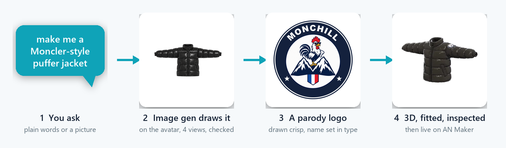
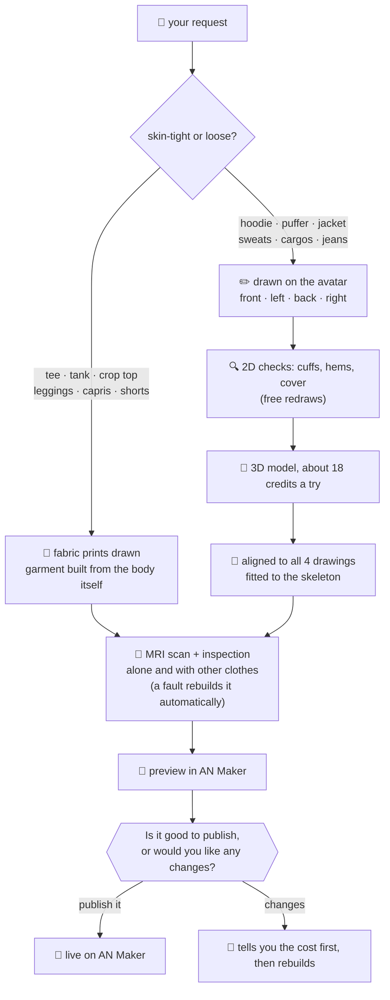
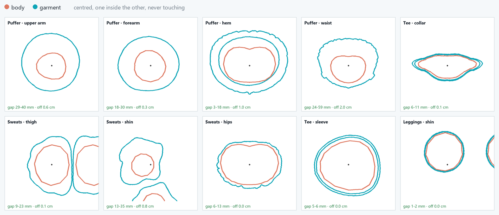
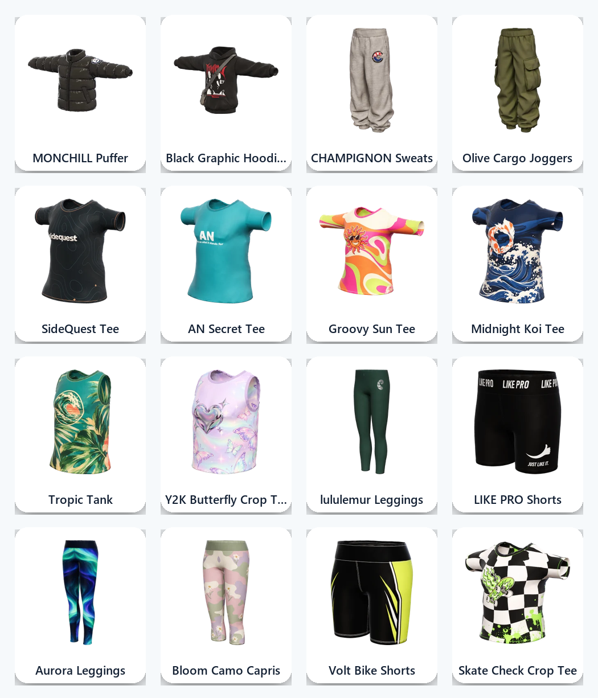

  

  
  
  
  
  

<b>Make new clothes for the AN Maker avatar just by asking.</b> 
Tops, bottoms and jackets, from a sentence or a picture: drawn, built in 3D, fitted, scanned slice by slice,
and put live on AN Maker when you say so.

---

## Start in 3 steps

| | | |
|:-:|---|---|
| **1** | **Download** | Green **Code** button above → **Download ZIP**. Leave it in Downloads. No unzipping. |
| **2** | **Let it work** | Open **Claude Code** or **Codex** and switch the mode at the bottom left (picture below). |
| **3** | **Drop & say** | Drag the zip into the chat and type **`set me up`**. That's it. |

  

> **Why step 2?** Setup runs a few dozen commands (installing Blender, linking updates, building the preview). In the
> default modes you'd have to click *Allow* on every one. In Claude Code, pick **Bypass permissions** (if it says
> *Auto*, *Ask permissions* or anything else, switch it). In Codex, pick **Full access**. The assistant still never
> touches the site or the pipeline: those files are locked for it on your machine.

## What "set me up" does

**The questions** (one at a time, each with a sensible default):

1. Your name, for credits on what you make.
2. Which 3D account to use for loose clothes: **Higgsfield**, or none for now.
3. A spending limit per garment (default 50 credits).
4. *Only if needed:* whether you have a ChatGPT plan, for free drawings through Codex. Inside Codex it already knows.

**It installs everything itself.** Nothing for you to download:

| Tool | Why | How |
|---|---|---|
| Python | runs the pipeline | `winget`, just for you (no admin) |
| Blender 5.2 LTS | builds, fits and scans the 3D garments | portable copy from blender.org, no admin |
| Git | automatic updates | `winget` (Windows may ask once: click **Yes**) |
| Node.js + Codex / Higgsfield tools | drawings and 3D models | `winget` + `npm`, only the ones your answers need |

**The only thing you do by hand is sign in**, in your own browser or your own PowerShell window. Never paste a
password or key into the chat: the assistant will never ask you to.

It also adds a small skill to Claude Code and a note to Codex. After that, **any new chat** knows the garment maker,
from any folder.

## Make something

Just say what you want:

- *make me a Moncler-style puffer jacket*
- *pink camo leggings*
- *baggy sweatpants like Champion, grey*
- *a cropped tank with a retro sunset print*
- or drop in a picture: *make a hoodie inspired by this*

  

You never pick a pipeline, a file or a number. The assistant picks the right track for you:

Brands are always **parodies**: Moncler becomes MONCHILL, Champion becomes CHAMPIGNON, Lululemon becomes lululemur.

**Realistic textures, every time.**
- **Fitted pieces** use the exact recipe behind the Y2K Butterfly tank and the leggings:
  - the print is drawn as flat fabric yardage, with a separate chest graphic, and upscaled;
  - it gets a real knit normal map and roughness, so it reads as cotton jersey or stretch fabric, not plastic.
- **3D pieces** keep the 3D model's own full-resolution texture (2048 px), gently sharpened.
- **Logos** are drawn separately and baked on crisp, never garbled: a garbled generated logo is redrawn in place, or
  a patch is added on the sleeve.

## The MRI scan

Every garment, on every track, is sliced like an MRI before you ever see it: at the collar, along both sleeves and
cuffs, at the waistband or hem, and down both legs. In each slice the **body is one ring and the garment another**.
They have to sit centred, one inside the other, and **never touch**. This is the same alignment process that fits
the MONCHILL puffer and the CHAMPIGNON sweats.

  

Alongside the scan it checks:
- that each arm and leg comes out through its own opening;
- for skin poking through anywhere;
- the layer order and spacing over a tee and joggers;
- every sleeve opening and cuff;
- the views from 6 angles at every joint.

A structural fault means it builds the garment again automatically, within your spending limit. Meshes are never
hand-edited: what you see is what was generated.

## Costs, and what a change costs

The assistant always tells you the cost **before** it spends anything, and never goes over your limit without asking.

| What | Drawings with Codex (ChatGPT plan) | Drawings on Higgsfield (paid per image) | 3D model (Higgsfield) |
|---|---|---|---|
| Fitted tee, tank, crop top | free | about 3 images | none |
| Leggings, capris, bike shorts | free | 1 image | none |
| Loose 3D garment (hoodie, puffer, sweats…) | free | about 8 images | about 18 credits a try, usually 1-2 |
| Change a print, colour or logo | free | 1-3 images | none |
| Change a 3D garment's shape or look | free | about 8 images | a new 3D model, about 18 credits a try |

## Always asked, never auto-published

When a garment is done, the assistant shows it to you in the preview and **always** asks:

> **"Is it good to publish, or would you like any changes?"**

- **Changes?** Say what you'd like. It tells you what it costs, then rebuilds.
- **Happy?** Say **publish it**. It saves your garment and puts it live on **[an-maker.pages.dev](https://an-maker.pages.dev)**
  in about a minute.

Publishing works the same from Claude Code or Codex, and it's free: the site is a private GitHub repo that Cloudflare
Pages serves, so publishing is just a push. It only ever sends your garment's files, never the page itself.

## The wardrobe so far

  

## What it can and can't make

| ✅ Ready | ⏳ Not yet (owner only) |
|---|---|
| Tees, tanks, crop tops, fitted long sleeves | Hair, shoes, hats, bags, accessories |
| Leggings, capris, bike and compression shorts | Dresses, skirts, jumpsuits |
| Hoodies, sweatshirts, jackets, puffers, coats, cardigans | Makeup, faces, expressions |
| Joggers, sweatpants, cargos, jeans, loose shorts | Animations, the AN Maker page itself |

## Under the hood

You never need to type these: the assistant runs them. They are listed here so you can see exactly what happens.

| Command | What it does |
|---|---|
| `python pipeline/garment.py setup …` | installs to `%USERPROFILE%\an-maker`, installs the tools, saves your answers, links updates, runs the doctor |
| `python pipeline/garment.py update` | pulls the newest pipeline (run first, every time) |
| `python pipeline/garment.py doctor` | checks every tool and sign-in, and says exactly what to fix |
| `python pipeline/garment.py shell-top …` | a fitted tee, tank or crop top |
| `python pipeline/garment.py shell-bottom …` | leggings, capris or shorts |
| `python pipeline/garment.py generated …` | a loose 3D garment: drawings, checks, 3D, fit, MRI, inspection |
| `python pipeline/garment.py emblem …` / `badge …` | draws a parody logo and bakes it on crisply |
| `python pipeline/garment.py image …` | one image with whichever image provider this PC uses |
| `python pipeline/garment.py export` / `preview` | rebuilds the wardrobe and shows it at http://localhost:8765 |
| `python pipeline/garment.py save --key …` | saves your garment to GitHub for the owner |
| `python pipeline/garment.py publish --key …` | puts it live on an-maker.pages.dev (only when you say *publish it*) |

The assistant's full playbook is [`docs/garment-agent.md`](docs/garment-agent.md). How the pipeline works and why:
[`docs/clothing-pipeline.md`](docs/clothing-pipeline.md).

## Updates

Automatic. Every time you make something, it pulls the newest version first and tells you what's new. Nothing to do.

## If something's off

Say **run the doctor**. It checks every tool and sign-in and tells you exactly what to fix (and fixes what it can).

The app won't take a zip?

Type `set me up from` followed by where the zip is, for example
`set me up from C:\Users\Rick\Downloads\an-maker-main.zip`.

For the owner

Adding a teammate, the site (Cloudflare Pages, free) and keeping them updated: [`docs/handoff.md`](docs/handoff.md).

